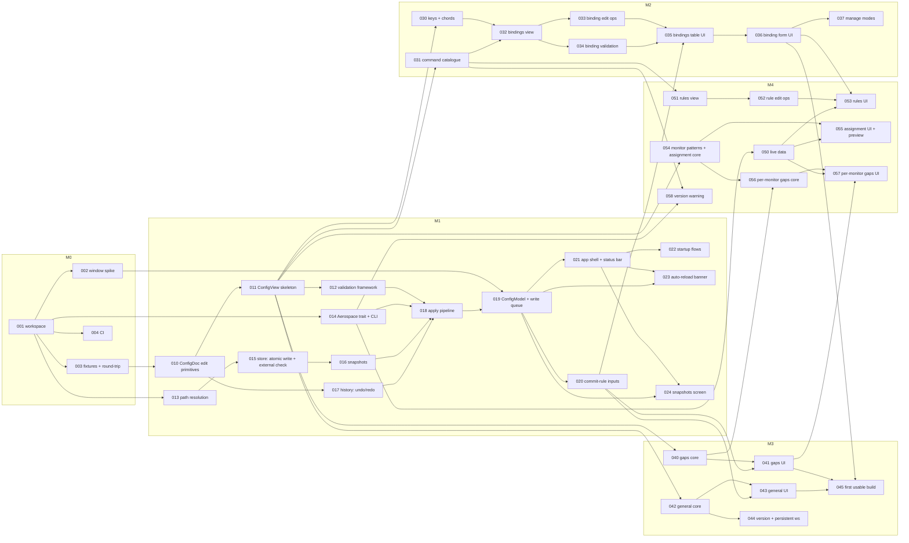

# PlaneUI: implementation roadmap

How we get from an empty Cargo project to the v1 described in [PRD.md](PRD.md), using the
research and architecture in [SPEC.md](SPEC.md) and the rules in [AGENTS.md](../AGENTS.md).
Tickets live in [`docs/tickets/`](tickets/), one file per milestone.

## Contents

1. [Principles](#principles)
2. [Where the sources disagree](#where-the-sources-disagree)
3. [Milestones](#milestones)
4. [Dependency graph](#dependency-graph)
5. [Requirement traceability](#requirement-traceability)
6. [Decisions](#decisions)
7. [Ticket conventions](#ticket-conventions)

## Principles

- **Core first, UI second.** Every feature lands as a `planeui-core` ticket (view + edit ops +
  validation + tests, runs on Linux) before the `planeui-app` ticket that puts a form on it.
  UI tickets are wiring only.
- **The apply engine is the product.** M1 builds and proves the pipeline (validate → external
  check → snapshot → atomic write → reload) end to end before any section editor exists. Every
  later editor is "produce a new document, hand it to the pipeline".
- **Read-only before editable.** Each section first shows everything in the file, with
  unsupported shapes marked read-only, then gains edit ops. Nothing is ever rewritten that the
  app cannot round-trip.
- **Each milestone ends with something runnable** and with `fmt`, `clippy -D warnings`, `test`
  and `cargo deny check` green.
- **M3 exit is the first usable build.** From then on Sander uses PlaneUI for real edits and bugs
  found go to the front of the queue (every fix starts with a failing test).

## Where the sources disagree

The PRD wins on behavior (AGENTS.md says so). AGENTS.md wins on code structure and tooling,
because it is the most specific and most recent. The roadmap follows these resolutions:

| Topic | SPEC.md | PRD.md / AGENTS.md | Roadmap follows |
|---|---|---|---|
| Saving | Cmd-S, diff preview before save | Save + reload on every committed change, no Cmd-S (F4) | PRD: no diff preview, no Save |
| Backups | Keep 20 | Snapshot before every write, keep 10 (U3) | PRD: 10 |
| Raw TOML tab | v1 | Out of scope in v1 | PRD: not built |
| Callbacks / exec editors | v1 | Non-goal, preserved untouched | PRD: not built, listed read-only (A4) |
| Legacy `if.app-id` | Offer one-click migration | No conversion (W4) | PRD: keep legacy syntax |
| Typed chord text field (`alt-h`) | Synced with checkboxes | Checkboxes + key dropdown (K2) | PRD: no text field |
| Command entry | Free text + grammar completion | Structured picker, no free text (K4) | PRD: structured only |
| Text-field debounce | — | AGENTS ~500 ms, PRD 700 ms text / 400 ms steppers (F5) | PRD: 700 / 400 ms |
| Crates | `aerospace-config`, `aerospace-commands`, `aerospace-cli`, `aerospace-gui` | PRD: three crates; AGENTS: `planeui-core` + `planeui-app` | AGENTS: two crates; CLI code is `planeui-core/src/aerospace.rs` behind a trait |
| Command catalogue | `build.rs` codegen from vendored BNF | No `build.rs` (AGENTS) | Hand-written catalogue in `commands.rs`, pinned to 0.21.x |
| External edits | `notify` file watcher | Hash check before every write (AGENTS invariant 5, F9) | Content check before write + on window activation; no `notify` |
| Extra deps | `indexmap`, `regex`, `similar`, `notify`, `directories` | Expected set: `dirs`, `similar` (dev only); ask before adding | See [decisions](#decisions) |
| Diagnostics panel | Separate panel with jump-to-field | Inline errors, section badges, reload error banner (F7, F8, A2) | PRD: inline + banner, no panel |
| Signing / notarisation | M4 Ship | Non-goal | Local `.app` bundle only |

## Milestones

Sizes are focused days. "Ticket sum" adds the ticket sizes (S = 0.5, M = 1, L = 2).

| Milestone | Goal | Tickets | PRD estimate | Ticket sum | Exit criteria |
|---|---|---|---|---|---|
| [M0 Spike](tickets/M0-spike.md) | Workspace skeleton, GPUI window, lossless round-trip proven on real configs | PUI-001 – PUI-004 | 1–2 | 2.75 | `cargo run -p planeui-app` opens a window; round-trip test passes on every fixture incl. Sander's real config |
| [M1 Apply engine](tickets/M1-apply-engine.md) | Locate, edit, validate, snapshot, write, reload, undo — wired into an app shell | PUI-010 – PUI-024 | 5–7 | 13.5 | A debug "set accordion-padding" control round-trips through the full pipeline; Cmd-Z restores bytes exactly; snapshots rotate at 10; external edits are never clobbered |
| [M2 Keybindings](tickets/M2-keybindings.md) | Bindings per mode with chord form, command picker, conflicts, read-only advanced bindings | PUI-030 – PUI-037 | 6–8 | 9.5 | Add/edit/duplicate/delete bindings in any mode; unsupported bindings untouched byte-for-byte |
| [M3 Gaps and General](tickets/M3-gaps-general.md) | Constant gaps, general settings, config-version, persistent workspaces | PUI-040 – PUI-045 | 2–3 | 4.5 | **First usable build**; dogfooding starts |
| [M4 Rules and monitors](tickets/M4-rules-monitors.md) | Window rules, workspace-to-monitor, per-monitor gaps, all on live data | PUI-050 – PUI-058 | 6–8 | 9 | Rules and assignments editable with live app/monitor pickers; legacy/complex rules untouched |
| [M5 Polish](tickets/M5-polish.md) | Native menus, badges, "Other settings", keyboard/theme audit, `.app` bundle, perf check, a week of use | PUI-060 – PUI-066 | 2–3 | 5.25 | Installed `PlaneUI.app`; NFR latency/startup numbers measured and met |
| [Backlog](tickets/backlog.md) | Could-haves (K8, U5, W5) and post-v1 ideas | PUI-090+ | — | — | Not scheduled |

The ticket sum (about 44 days) is well above the PRD's 22–31 days. Three reasons: the sizes
round up; M1 now includes the app shell, status bar and snapshots screen, which the PRD puts
partly in M5; and the PRD estimate did not budget the test work AGENTS.md requires (insta diffs
and proptests for every edit op). To get back toward the PRD number, cut in this order: K7
(PUI-037), S3 (PUI-044), G2 (PUI-056/057), then M3 pattern preview. All four are Should-haves.

## Dependency graph

Ticket-level dependencies. Arrows read "is needed by". Within a milestone, tickets without an
arrow between them can run in parallel.

M5 tickets depend on everything before them and are mostly independent of each other.

## Requirement traceability

Every PRD requirement maps to at least one ticket.

| Req | Priority | Tickets |
|---|---|---|
| F1 Find and open config | Must | 013, 014, 022 |
| F2 Lossless round-trip | Must | 003, 010 |
| F3 Targeted edits only | Must | 010, 033, 040, 042, 052, 054, 056 |
| F4 Instant save and reload | Must | 018, 019 |
| F5 Commit rules | Must | 020 |
| F6 Coalesced writes | Must | 019 |
| F7 Invalid changes never written | Must | 012, 018, 020, 061 |
| F8 Reload result feedback | Must | 014, 019, 021 |
| F9 External edits respected | Must | 015, 018, 019 |
| F10 Symlink-safe atomic writes | Must | 013, 015 |
| F11 AeroSpace not running | Should | 014, 019, 050 |
| F12 Offer to turn off auto-reload | Must | 023 |
| U1 Undo/redo | Must | 017, 019 |
| U2 Undo is exact | Must | 017 |
| U3 Snapshot before every write | Must | 016, 018 |
| U4 Restore a snapshot | Must | 016, 024 |
| U5 Undo history panel | Could | 091 |
| K1 Bindings per mode | Must | 032, 033, 035 |
| K2 Chord entry by form | Must | 030, 036 |
| K3 Conflict detection | Must | 030, 034, 036 |
| K4 Structured command picker | Must | 031, 036 |
| K5 Command catalogue v1 | Must | 031 |
| K6 Unsupported bindings intact | Must | 031, 032, 035 |
| K7 Manage modes | Should | 037 |
| K8 Search and filter | Could | 090 |
| G1 Constant gaps | Must | 040, 041 |
| G2 Per-monitor gaps | Should | 056, 057 |
| S1 Scalar settings form | Must | 042, 043 |
| S2 Defaults visible | Must | 042, 043 |
| S3 Config version + persistent workspaces | Should | 044 |
| W1 Rule list | Must | 051, 052, 053 |
| W2 Conditions from live data | Must | 050, 053 |
| W3 Actions | Must | 052, 053 |
| W4 Syntax handling | Must | 051, 052 |
| W5 Rule from focused window | Could | 092 |
| M1 Assignment table | Must | 054, 055 |
| M2 Monitors from live data | Must | 050, 055 |
| M3 Pattern preview | Should | 054, 055 |
| A1 Regular Dock app | Must | 002, 060, 063 |
| A2 Navigation + badges | Must | 021, 061 |
| A3 Status bar | Must | 021 |
| A4 Out-of-scope keys visible | Should | 011, 061 |
| NFR Fidelity | — | 003, 010 (proptest) |
| NFR Latency / Startup | — | 065 |
| NFR Robustness (3 s timeout) | — | 014, 064 |
| NFR Compatibility warning | — | 058 |
| NFR Usability (keyboard, light/dark) | — | 062 |
| NFR Privacy (no network) | — | 001 (`cargo deny` bans), review in 066 |

## Decisions

Decided by Sander on 31 Oct 2026.

| # | Topic | Needed by | Decision |
|---|---|---|---|
| D0 | Scope vs the PRD estimate | all | Keep full v1 scope and accept the ~44-day ticket sum |
| D1 | Snapshot timestamps | 016, 024 | Hand-roll UTC `YYYYMMDDTHHMMSS.mmmZ` file names with a small tested civil-date function; add `jiff` only if local-time display gets messy (ask again then) |
| D2 | `similar` for the Snapshots line-count diff | 024 | Approved: normal `planeui-core` dependency (already in the tree via gpui-kit) |
| D3 | `regex` for monitor-pattern and rule-regex checks | 051, 054 | Approved: warning-only check; AeroSpace's reload output stays the final judge |
| D4 | CI host | 004 | GitHub Actions on `SanderSpiegelaar/plane-ui`: Linux job for `planeui-core`, macOS job for the workspace |
| D5 | Real config fixture | 003 | Commit Sander's real config unchanged as `sander.toml`: the repo is private and the file has no secrets. Explicit exception to the AGENTS.md "no real personal config files" rule |

`indexmap` (SPEC) is not needed: the view uses `Vec`s in file order. `notify` and
`directories` are replaced by the hash check and `dirs`.

## Ticket conventions

- IDs: `PUI-0xx`. Tens group by milestone (00s M0, 10s/20s M1, 30s M2, 40s M3, 50s M4, 60s M5,
  90s backlog).
- Each ticket has: milestone, PRD requirements, crate, depends-on, size, goal, scope,
  acceptance criteria (checkboxes) and tests. "Out of scope" lines stop scope creep.
- Size: **S** ≤ half a day, **M** about a day, **L** two to three days. Anything bigger is split.
- Definition of done for every ticket: acceptance criteria met; tests named in the ticket exist
  and pass; the full AGENTS.md command list passes with zero warnings; insta diffs reviewed;
  commit follows AGENTS.md style; PR description names the PRD requirement.
- Safety tickets (anything touching load, edit, write) must add tests that prove the
  config-safety invariants they touch, even when not spelled out in the ticket.
