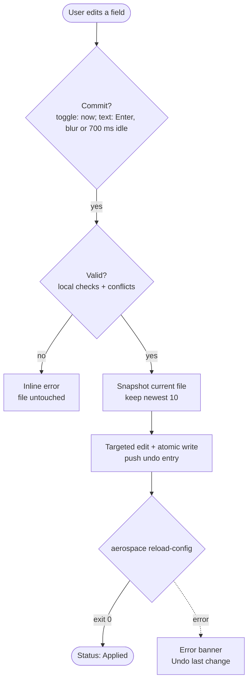

# PlaneUI: PRD

Product requirements for PlaneUI, a personal macOS app that edits the AeroSpace config through forms, saves and reloads AeroSpace on every change, and never loses a byte it does not own. Built on the research and technical spec Page.

- Page: [PlaneUI: PRD](https://cursor.com/canvas/store-8519c30d-fb64-4642-8dcf-da4a8d5c6324/da35ffd3-383b-4ab3-bd59-c67cab5faa0d)
- Spec: [AeroSpace config GUI (GPUI): research and spec](https://cursor.com/canvas/store-8519c30d-fb64-4642-8dcf-da4a8d5c6324/85ef382f-6b4a-4053-ba93-5a24ca677c13)

## Contents

1. [Problem and goals](#problem-and-goals)
2. [Non-goals](#non-goals)
3. [User and context](#user-and-context)
4. [User stories](#user-stories)
5. [Functional requirements](#functional-requirements)
6. [UX flows](#ux-flows)
7. [Non-functional requirements](#non-functional-requirements)
8. [Technical approach](#technical-approach)
9. [Milestones](#milestones)
10. [Risks](#risks)
11. [Decisions](#decisions)
12. [References](#references)

## Problem and goals

Editing `aerospace.toml` by hand means remembering chord and key names, the command syntax, bundle ids and monitor names, and TOML structure rules that silently break things (a root key placed after a table gets absorbed into it). Mistakes show up only after a reload, and AeroSpace drops broken parts while loading the rest. AeroSpace's author has said upstream will never ship a configuration GUI.

- Change bindings, gaps, general settings, window rules and workspace-to-monitor assignments through forms, with every change live in AeroSpace within a second.
- Never write an invalid config; never lose a comment or an unsupported key.
- Make any change reversible: in-app undo plus the last 10 config snapshots.
- Use live data (running apps, connected monitors) instead of looking up ids.

**Success looks like:** Sander makes his routine AeroSpace changes in PlaneUI instead of a text editor, with zero lost comments and no broken reloads over a month of use.

## Non-goals

- Editing after-startup-command, callbacks (on-focus-changed, on-mode-changed, on-focused-monitor-changed, exec-on-workspace-change) and exec env vars. They are preserved untouched; maybe later.
- A free-text command editor or a raw TOML editor in v1.
- A keybinding recorder.
- Converting legacy `if.app-id` window rules to the new syntax.
- A menu bar app, window management features, or replacing AeroSpace's tray menu.
- Open-source release, signing and notarisation, auto-update, Linux or Windows.
- Supporting AeroSpace forks (e.g. aerospork).

## User and context

| | |
|---|---|
| **Product** | PlaneUI |
| **User** | Sander only: an engineer and daily AeroSpace user. Personal tool, not open source for now |
| **Platform** | macOS on his own Mac; built from source with `cargo`, installed as a local PlaneUI.app |
| **AeroSpace** | Current release line (0.21.x); the command catalogue is pinned to the installed version |
| **Usage pattern** | Short sessions to tweak bindings, add a rule for a new app, adjust gaps after a monitor change |

## User stories

1. As Sander, I want to add a binding by ticking modifiers, picking a key and picking a command with its arguments, so I don't need to remember names or syntax.
2. As Sander, I want to be told immediately when a chord is already used in that mode, so I don't silently override a binding.
3. As Sander, I want each change to take effect in AeroSpace right away, so I can try it without a save-and-reload ritual.
4. As Sander, I want to press Cmd-Z to undo a change that felt wrong, and have AeroSpace go back too.
5. As Sander, I want to restore one of my last 10 config versions when an experiment went too far.
6. As Sander, I want to create a window rule by picking a running app from a list, so I never look up a bundle id.
7. As Sander, I want to assign workspaces to monitors by picking from my connected monitors.
8. As Sander, I want to tune gaps, and later per monitor, and see the result on screen.
9. As Sander, I want my comments, ordering and the parts of the file the app doesn't understand to stay exactly as I wrote them.
10. As Sander, I want invalid input to stay in the form with an error, so my running config is never broken by a typo.

## Functional requirements

Priorities: Must is required for v1 (33), Should is planned for v1 if time allows (6), Could is later (3). Each row gives the requirement and its acceptance criteria.

### File handling and apply pipeline

| ID | Priority | Requirement | Acceptance criteria |
|---|---|---|---|
| F1 | Must | Find and open the active config | Uses `aerospace config --config-path` when AeroSpace runs, else `~/.aerospace.toml` or `~/.config/aerospace/aerospace.toml`. If both exist, shows which one AeroSpace would reject and opens nothing until resolved. If none exists, offers to create one from AeroSpace's default config. |
| F2 | Must | Lossless round-trip | Opening and writing the file with no edits produces byte-identical output. Comments, blank lines, key order, quoting, dotted vs table style and every unknown or unsupported key are preserved. |
| F3 | Must | Targeted edits only | A change touches only the key or array element it concerns; the diff of any single edit is limited to those lines. New keys are inserted next to their siblings in the file's existing style. |
| F4 | Must | Instant save and reload | Every committed change is written to disk and followed by `aerospace reload-config --no-gui`. No Save button and no Cmd-S. |
| F5 | Must | Commit rules for inputs | Toggles, checkboxes, dropdowns, pickers and add/delete/reorder commit immediately. Text and number fields commit on Enter, on blur, or after 700 ms without typing, and only when valid. Steppers commit 400 ms after the last click. No reload ever happens per keystroke. |
| F6 | Must | Coalesced writes | Writes and reloads run one at a time. Changes made while a reload is running are merged into one trailing write and reload. The UI never blocks while this happens. |
| F7 | Must | Invalid changes are never written | A field that fails validation shows an inline error and the file on disk keeps its last valid state until the value is fixed or reverted. Leaving the field keeps the error visible; the section shows an error badge. |
| F8 | Must | Reload result feedback | Status bar shows 'Applied' with time after a successful reload. A non-zero exit shows AeroSpace's error text in a banner with an 'Undo last change' action. |
| F9 | Must | External edits respected | If the file changes on disk outside the app, the app reloads its view from disk before the next write and never overwrites the external change. A toast says 'Reloaded from disk'. |
| F10 | Must | Symlink-safe writes | If the config is a symlink (dotfiles repo), the target file is written and the link is kept. Writes are atomic (temp file in the same directory, then rename). |
| F11 | Should | AeroSpace not running | Edits are still written; reload is skipped and the status bar says 'AeroSpace not running: changes apply on next start'. Live pickers fall back to manual entry. |
| F12 | Must | Offer to turn off auto-reload-config | When the opened config has `auto-reload-config = true`, a banner explains that PlaneUI already reloads after every change and offers 'Turn off' and 'Keep on'. 'Turn off' sets the key to false through the normal pipeline (snapshot, write, reload) and can be undone with Cmd-Z. 'Keep on' dismisses the banner and is remembered for that config path; PlaneUI still forces its own reload. If the user later turns it back on in General settings, the banner is not shown again. |

### Undo and snapshots

| ID | Priority | Requirement | Acceptance criteria |
|---|---|---|---|
| U1 | Must | Undo and redo history | Cmd-Z undoes the last committed change and Cmd-Shift-Z redoes it, across all sections, for the whole session. Each undo or redo writes the file and reloads AeroSpace, like any other change. |
| U2 | Must | Undo is exact | Undoing a change restores the file byte-for-byte to its state before that change, comments included. The in-session undo history is kept in memory and is not limited by the 10 snapshots. |
| U3 | Must | Snapshot before every write | Before any write to the config file (edits, undo, redo, restore, turning off auto-reload), the current file is copied byte-for-byte to `~/Library/Application Support/PlaneUI/snapshots/` with a timestamped name. Only the newest 10 snapshots are kept; the oldest is deleted when an 11th is created. A failed snapshot blocks the write and shows an error. |
| U4 | Must | Restore a snapshot | A Snapshots screen lists the 10 snapshots with date and time and a line-count diff against the current file. Restore reads the chosen snapshot first, then snapshots the current file (rotation applies), writes the chosen content and reloads. The restore can be undone with Cmd-Z. |
| U5 | Could | Undo history panel | A side panel lists the session's changes in plain language ('Added alt-shift-p in main') and jumps back to any point. |

### Keybindings

| ID | Priority | Requirement | Acceptance criteria |
|---|---|---|---|
| K1 | Must | Bindings per mode | Mode tabs (main first) each show a table of chord, commands and inline comment. Add, edit, duplicate to another mode and delete work and save instantly. |
| K2 | Must | Chord entry by form | Modifier checkboxes (cmd, alt, ctrl, shift) and a searchable key dropdown listing every AeroSpace key name plus `key-mapping` aliases. No key recorder. Modifier order in the file follows existing style; new bindings use `alt-shift-x` order. |
| K3 | Must | Conflict detection | Choosing a chord already used in the same mode shows an inline error naming the existing binding and blocks the commit. Chords are compared after normalising modifier order and aliases. |
| K4 | Must | Structured command picker | Commands are chosen from a list; each command's arguments are typed fields (direction dropdown, workspace name with suggestions, mode dropdown, signed number, layout options). A binding can hold an ordered list of commands. No free-text command field in v1. |
| K5 | Must | Command catalogue v1 | Covers at least: workspace, move-node-to-workspace, workspace-back-and-forth, focus, move, resize, layout, fullscreen, join-with, flatten-workspace-tree, balance-sizes, close, close-all-windows-but-current, focus-monitor, move-node-to-monitor, move-workspace-to-monitor, mode, reload-config, exec-and-forget (shell command as one text argument). |
| K6 | Must | Unsupported bindings stay intact | Bindings whose commands use shell operators (`&&`, `\|\|`, `\|`), unknown commands or flags outside the catalogue are listed read-only with a note 'edit in a text editor', and are never rewritten. |
| K7 | Should | Manage modes | Create and delete modes. Deleting a mode that other bindings switch to is blocked with a list of those bindings. A warning shows when a non-main mode has no binding back to main. |
| K8 | Could | Search and filter | Filter the table by key, modifier or command text across all modes. |

### Gaps

| ID | Priority | Requirement | Acceptance criteria |
|---|---|---|---|
| G1 | Must | Constant gaps | Six number fields (inner horizontal, inner vertical, outer left, right, top, bottom), integers 0 or more, with a 'link all outer' toggle. Gaps that already use per-monitor arrays are shown read-only until G2 ships, and never rewritten. |
| G2 | Should | Per-monitor gaps (M4) | Not in the first usable build; delivered in M4 alongside live monitor data. Any gap can switch to per-monitor: a list of monitor pattern + value rows (patterns picked from live monitors or typed) and a default value, written as AeroSpace's array syntax. |

### General settings

| ID | Priority | Requirement | Acceptance criteria |
|---|---|---|---|
| S1 | Must | Scalar settings form | Editors for start-at-login, auto-reload-config, accordion-padding, default-root-container-layout, default-root-container-orientation, both normalization flags, automatically-unhide-macos-hidden-apps, focus-follows-mouse.enabled and key-mapping.preset. |
| S2 | Must | Defaults are visible | A key absent from the file shows its effective default (e.g. 'default: 30'). Setting a value adds the key; 'Reset to default' removes it. |
| S3 | Should | Config version and persistent workspaces | Shows config-version with a one-click upgrade to 2 and an editable persistent-workspaces list, with a note on the v1 to v2 behaviour change. |

### Window rules

| ID | Priority | Requirement | Acceptance criteria |
|---|---|---|---|
| W1 | Must | Rule list | on-window-detected rules show as ordered cards ('When … then …'), with add, edit, delete and drag to reorder. Order is preserved exactly in the file. |
| W2 | Must | Conditions from live data | Condition 'app is' offers a searchable list from `aerospace list-apps --json` (name and bundle id); manual bundle id entry remains available. Also: app name matches, window title matches, workspace is. |
| W3 | Must | Actions | Actions are picked from the same structured command catalogue (typically move-node-to-workspace and layout floating or tiling), plus the 'keep checking further rules' toggle. |
| W4 | Must | Syntax handling | New rules are written as `if = 'test %{app-bundle-id} = …'`. Existing legacy `if.app-id` rules keep their legacy syntax when edited; no conversion is offered. Rules with complex `if` expressions are shown read-only. |
| W5 | Could | Rule from focused window | 'New rule from a window' lists open windows (`list-windows --all --json`) and prefills app and title. |

### Workspace-to-monitor assignment

| ID | Priority | Requirement | Acceptance criteria |
|---|---|---|---|
| M1 | Must | Assignment table | Rows of workspace name and an ordered list of monitor patterns; add, edit, delete and reorder patterns. |
| M2 | Must | Monitors from live data | Pattern picker offers main, secondary, each monitor index and name from `aerospace list-monitors --json`; free regex entry remains available and is validated. |
| M3 | Should | Pattern preview | Each row shows which currently connected monitor the patterns resolve to, or 'no match'. |

### App shell

| ID | Priority | Requirement | Acceptance criteria |
|---|---|---|---|
| A1 | Must | Regular Dock app | PlaneUI opens as a normal resizable window with a Dock icon and the standard macOS menu bar (App, Edit with Undo, Redo, Copy, Paste, and Window menus). Not a menu bar extra. |
| A2 | Must | Navigation | Sidebar: Keybindings, Gaps, General, Window rules, Workspaces and monitors, Snapshots. Sections with invalid fields show a badge. |
| A3 | Must | Status bar | Shows config path, AeroSpace version, running state and last apply result. |
| A4 | Should | Out-of-scope keys visible | An 'Other settings in your file' list names keys the app does not edit (e.g. after-startup-command, exec) so it is clear they are kept, not lost. |

## UX flows

### Change pipeline

### First launch

1. **Open PlaneUI from the Dock.** It finds the active config and checks AeroSpace is running.
2. **Auto-reload banner, if enabled.** 'Turn off' or 'Keep on' (F12); either way PlaneUI reloads after each change.
3. **Land on Keybindings.** Status bar shows path, AeroSpace version and state.

### Add a keybinding

1. **Keybindings, pick mode tab, Add binding.** A form row opens at the top of the table.
2. **Tick modifiers, pick a key.** Conflict error appears instantly if the chord is taken in this mode.
3. **Pick command and fill its arguments.** Add more commands to run in sequence if needed.
4. **Commit.** When the row is complete and valid, it is written and AeroSpace reloads; the status bar shows Applied.

### Add a window rule

1. **Window rules, New rule.** A card appears at the end of the list.
2. **Pick condition 'App is' and choose a running app.** List comes from list-apps; bundle id filled in.
3. **Pick actions.** For example move to workspace B, then layout floating.
4. **Drag to position.** Order matters; the first matching rule wins unless 'keep checking' is on.

### Recover

1. **Cmd-Z.** Reverts the last change in the file and reloads; repeat to go further back in this session.
2. **Snapshots screen.** Pick one of the last 10 snapshots, see what differs, Restore. The current file is snapshotted first.

## Non-functional requirements

| Area | Requirement |
|---|---|
| Fidelity | Byte-identical round-trip on a corpus of real configs; single edits change only their own lines |
| Safety | Invalid state is never written; every write is preceded by a snapshot; writes are atomic; external changes are never overwritten |
| Latency | Commit to 'Applied' under 500 ms on Sander's Mac, snapshot included; UI stays responsive during reloads |
| Startup | Window with config loaded in under 1 s |
| Robustness | CLI calls time out after 3 s; AeroSpace not running is a normal state, not a crash |
| Compatibility | Targets the installed AeroSpace 0.21.x; shows a warning if the version is newer than the catalogue |
| Storage | At most 10 snapshots on disk (a few hundred KB) |
| Privacy | No network access and no telemetry |
| Usability | Fully keyboard navigable; follows system light and dark mode |
| Maintainability | Config logic lives in a GUI-free Rust crate with its own tests |

## Technical approach

- Rust workspace: `aerospace-config` (toml_edit document, typed view, edit operations, validation, snapshots), `aerospace-cli` (runs `aerospace` and parses JSON), and the `planeui` GPUI app.
- UI on `gpui-kit` 0.8 (pinned GPUI snapshot plus gpui-component inputs, selects, switches, tables, sidebar).
- Undo stores whole-document snapshots in memory (configs are small), so undo is exact and simple; the 10 on-disk snapshots are a separate safety net.
- Validation mirrors AeroSpace's config parser and command grammar for the supported subset; AeroSpace's reload output is the final check.
- Live data from `list-apps --json`, `list-monitors --json`, `list-workspaces --all --json`, `config --config-path` and `--version`.

Research, schema catalogue, architecture and dependency choices are in the spec Page: [AeroSpace config GUI (GPUI): research and spec](https://cursor.com/canvas/store-8519c30d-fb64-4642-8dcf-da4a8d5c6324/85ef382f-6b4a-4053-ba93-5a24ca677c13)

## Milestones

| Milestone | Scope | Size |
|---|---|---|
| M0 Spike | gpui-kit window builds on Sander's Mac; toml_edit round-trip of his real config | 1-2 days |
| M1 Apply engine | F1-F12, U1-U4: locate, lossless edits, commit rules, coalesced write + reload, auto-reload offer, undo, 10-snapshot rotation, golden tests | 5-7 days |
| M2 Keybindings | K1-K7: mode tabs, chord form, command catalogue with argument fields, conflicts, read-only advanced bindings | 6-8 days |
| M3 Gaps and General | G1 (constant gaps), S1-S3. End of M3 is the first usable build | 2-3 days |
| M4 Rules, monitors, per-monitor gaps | W1-W4, M1-M3 and G2, all on live monitor and app data | 6-8 days |
| M5 Polish | A1-A4, PlaneUI app bundle and icon, a week of daily use and fixes | 2-3 days |

Rough estimate unchanged: 22-31 focused days, about 4.5-6 weeks. Moving G2 shifts about a day from M3 to M4; the simpler snapshot policy offsets the auto-reload banner in M1.

## Risks

| Risk | Mitigation |
|---|---|
| Instant apply means every mistake hits the live window manager | Strict validation before write, one-key undo, snapshot before every write |
| Only 10 snapshots: a burst of edits rotates out older versions quickly | In-session undo is unlimited; for older history, the config's dotfiles repo (if any) remains the long-term record |
| GPUI and gpui-kit churn (pre-1.0, weekly releases) | Pin exact versions; keep UI thin; upgrade deliberately |
| Lossy rewrite on unusual file layouts | Targeted edits only; read-only display for shapes the app cannot edit safely; golden tests |
| Command catalogue drifts from AeroSpace releases | Pin catalogue to installed version; unknown commands shown read-only, never rewritten |
| Reload storms or races | Commit rules plus serialized, coalesced writes |
| Double reload when auto-reload-config is on | PlaneUI offers to turn it off (F12); if kept on, the extra reload is harmless |

## Decisions

| Topic | Decision |
|---|---|
| App name | PlaneUI |
| Per-monitor gaps | Not in the first usable build; delivered in M4 (G2) |
| Legacy `if.app-id` rules | Kept as they are; no conversion offered (W4) |
| Backups | Snapshot before every write; keep the newest 10, rotate the oldest (U3) |
| auto-reload-config | PlaneUI offers to turn it off (F12) |
| Saving | Save and reload on every committed change; no Cmd-S (F4, F5) |
| Binding entry | Modifier checkboxes + key dropdown, structured command picker; no recorder, no free-text commands (K2, K4) |
| Unsupported content | Left untouched, byte-for-byte (F2, K6) |
| App type | Regular Dock app with a normal window (A1) |

Decisions as of 31 Oct 2026. No open questions remain.

## References

- [AeroSpace config GUI (GPUI): research and spec](https://cursor.com/canvas/store-8519c30d-fb64-4642-8dcf-da4a8d5c6324/85ef382f-6b4a-4053-ba93-5a24ca677c13) (Page)
- [AeroSpace guide](https://nikitabobko.github.io/AeroSpace/guide) (nikitabobko.github.io)
- [AeroSpace commands](https://nikitabobko.github.io/AeroSpace/commands) (nikitabobko.github.io)
- [default-config.toml](https://github.com/nikitabobko/AeroSpace/blob/main/docs/config-examples/default-config.toml) (github.com)
- [GPUI Kit (gpui-component)](https://github.com/longbridge/gpui-kit) (github.com)
- [toml_edit](https://docs.rs/toml_edit) (docs.rs)
