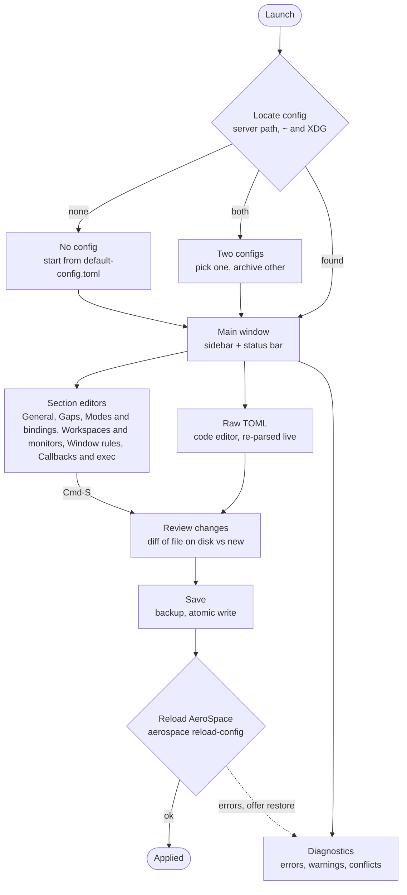
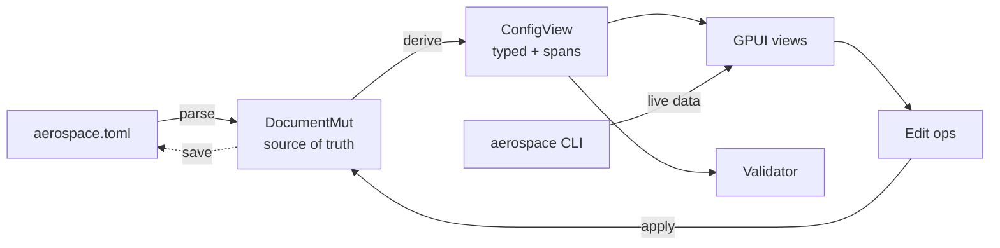

# AeroSpace config GUI in GPUI: research and spec

What AeroSpace's config really looks like today, where GPUI stands as a standalone framework, and a concrete, opinionated plan for a comment-preserving GUI editor. Researched 31 Oct 2026 against AeroSpace main and v0.21.3-Beta.

- Page: [AeroSpace config GUI (GPUI): research and spec](https://cursor.com/canvas/store-8519c30d-fb64-4642-8dcf-da4a8d5c6324/85ef382f-6b4a-4053-ba93-5a24ca677c13)

## Contents

- [Recommendation in brief](#recommendation-in-brief)
- [Research: AeroSpace config](#research-aerospace-config)
  - [Config surface](#config-surface)
  - [Bindings, commands and rules](#bindings-commands-and-rules)
  - [CLI hooks for a GUI](#cli-hooks-for-a-gui)
  - [Schemas, parsers and recent changes](#schemas-parsers-and-recent-changes)
- [Research: GPUI and components](#research-gpui-and-components)
- [Research: comment-preserving TOML](#research-comment-preserving-toml)
- [Research: prior art and user pain](#research-prior-art-and-user-pain)
- [Spec: goals and scope](#spec-goals-and-scope)
- [Spec: features by phase](#spec-features-by-phase)
- [Spec: UX and navigation](#spec-ux-and-navigation)
- [Spec: architecture](#spec-architecture)
- [Spec: dependencies](#spec-dependencies)
- [Milestones](#milestones)
- [Risks](#risks)
- [Open questions for Sander](#open-questions-for-sander)
- [Sources](#sources)

## Recommendation in brief

> **Build it, but treat it as a careful dotfile editor, not a settings app.**
> Upstream will never ship a config GUI, so there is room for one. The app edits the config file and forces `aerospace reload-config` after each save. The hard parts are not the widgets: they are lossless TOML round-trips, keeping up with AeroSpace's fast-moving command language, and a moving GPUI target.

- Depend on `gpui-kit` 0.8 (pins a GPUI snapshot and bundles gpui-component). The official `gpui` crate on crates.io is a year stale (0.2.2, Oct 2025).
- Split into a pure-Rust `aerospace-config` core (toml_edit, validation, tests on Linux CI) and a thin GPUI app.
- The UI never rewrites the file wholesale: every change is a targeted edit on a `toml_edit::DocumentMut`, shown as a diff before save.
- Validate locally (mirroring AeroSpace's Swift parser) before writing, then force `aerospace reload-config --no-gui` after every save and surface its errors.
- Bindings are entered in a plain form (modifier checkboxes + key dropdown, or typed `alt-h`) with validation and conflict detection; no key recorder.

## Research: AeroSpace config

| | |
|---|---|
| **Locations** | `~/.aerospace.toml` or `${XDG_CONFIG_HOME:-~/.config}/aerospace/aerospace.toml`; both present is a fatal 'ambiguous config' error; the server can also be started with a custom `--config-path` |
| **Format** | TOML 1.1.0 since v0.21.0 (multi-line inline tables are now recommended for rules) |
| **Fallbacks** | Scalar keys fall back to the default config; vector-like keys (`mode.*.binding`, `on-focused-monitor-changed`, `exec`) fall back to empty |
| **Parser** | Swift, `Sources/AppBundle/config/parseConfig.swift`: a key-to-parser table; unknown keys are errors |
| **Latest release** | v0.21.3-Beta (16 Jul 2026); main moves on daily |

### Config surface

| Key | Type | Fallback | GUI editor |
|---|---|---|---|
| `config-version` | int (1 or 2) | 1 if omitted | Banner + upgrade action |
| `after-startup-command` | command(s) | [] | Command list |
| `start-at-login` | bool | false | Switch |
| `auto-reload-config` | bool | false | Switch (warns: save = apply) |
| `enable-normalization-flatten-containers` | bool | true | Switch |
| `enable-normalization-opposite-orientation-for-nested-containers` | bool | true | Switch |
| `accordion-padding` | int | 30 | Number |
| `default-root-container-layout` | tiles \| accordion | tiles | Select |
| `default-root-container-orientation` | horizontal \| vertical \| auto | auto | Select |
| `automatically-unhide-macos-hidden-apps` | bool | false | Switch |
| `persistent-workspaces` | string[] | [] in v2; inferred from bindings in v1 | Workspace list |
| `on-focus-changed` | command(s) | [] | Callback editor |
| `on-focused-monitor-changed` | command(s) | [] | Callback editor |
| `on-mode-changed` | command(s) | [] | Callback editor |
| `exec-on-workspace-change` | argv string[] | [] | Argv editor |
| `exec.inherit-env-vars`, `exec.env-vars` | bool, table | true, PATH with Homebrew prefix | Env table |
| `key-mapping.preset`, `key-mapping.key-notation-to-key-code` | qwerty \| dvorak \| colemak, table | qwerty | Select + alias table |
| `focus-follows-mouse.enabled` | bool | false | Switch (0.21+) |
| `gaps.inner.*`, `gaps.outer.*` | int or per-monitor array | 0 | Gaps editor |
| `mode.<name>.binding` | table: chord to command(s) | {} (main must exist) | Bindings |
| `workspace-to-monitor-force-assignment` | table: workspace to pattern(s) | {} | Assignment grid |
| `on-window-detected` | array of {if, run, check-further-callbacks} | [] | Rule builder |
| Deprecated: `after-login-command`, `non-empty-workspaces-root-containers-layout-on-startup`, `indent-for-nested-containers-with-the-same-orientation` | various | error or ignored | Migration hint |

Per-monitor values (gaps only) use an array of single-key tables with a trailing default: `gaps.outer.top = [{ monitor.main = 16 }, { monitor."dell" = 32 }, 24]`. Monitor patterns are `main`, `secondary`, a 1-based index, or a case-insensitive regex substring, the same grammar as workspace-to-monitor assignment.

### Bindings, commands and rules

- Bindings live in `[mode.<name>.binding]`; `main` must exist. A chord is modifiers (`cmd`, `alt`, `ctrl`, `shift`) joined with `-` plus a key name: letters, digits, `keypad0-9`, `f1-f20`, named specials (`minus`, `leftSquareBracket`, `sectionSign`, …), keypad specials and arrows.
- Key names are QWERTY key codes unless `key-mapping.preset` is dvorak or colemak, or the user defines aliases in `key-mapping.key-notation-to-key-code`.
- The right-hand side is a string or array of strings in a mini shell: `;`, `||`, `&&`, `|` and parentheses, with `&&` binding tighter than `||` (unlike POSIX) and pipefail semantics. The parser was rewritten in 0.21 with some breaking corner cases.
- About 45 commands (workspace, move-node-to-workspace, layout, resize, mode, exec-and-forget, test, eval, summon-workspace, …); the full CLI grammar ships as `grammar/commands-bnf-grammar.txt` for shell completion.
- `on-window-detected` is an ordered list of `{ if, run, check-further-callbacks }`. New style: `if = 'test %{app-bundle-id} = com.foo'` (also `test-not`, `true`, `false`, `~=` regex). Legacy `if.app-id`, `if.app-name-regex-substring`, `if.window-title-regex-substring`, `if.workspace`, `if.during-aerospace-startup` still work forever. Since 0.21 a rule without `if` is an error.
- `workspace-to-monitor-force-assignment` maps workspace names to one pattern or an ordered list of patterns.
- Callbacks get `AEROSPACE_WINDOW_ID` or `AEROSPACE_WORKSPACE` in their environment; `exec-on-workspace-change` gets `AEROSPACE_FOCUSED_WORKSPACE` and `AEROSPACE_PREV_WORKSPACE`.

### CLI hooks for a GUI

| Command | Use in the GUI |
|---|---|
| `aerospace config --config-path` | Which file the running server actually loaded |
| `aerospace config --get mode --json` | Loaded bindings, to flag 'file differs from what is running' (only `mode.*` is exposed) |
| `aerospace reload-config --dry-run --no-gui [--warnings-as-errors]` | Authoritative validation of the file on disk; errors on stdout, non-zero exit |
| `aerospace reload-config --no-gui` | Forced after every save; stdout errors and exit code feed the diagnostics panel |
| `aerospace list-apps --json` | App picker for window rules (bundle id, name, paths) |
| `aerospace list-windows --focused --json` / `--all` | 'Make a rule for this window' with title and app |
| `aerospace list-monitors --json` | Monitor names, ids and main flag for patterns and per-monitor gaps |
| `aerospace list-workspaces --all --json` | Known workspace names |
| `aerospace list-exec-env-vars` | Preview the effective exec environment |
| `aerospace --version` | Feature-gate editors (e.g. focus-follows-mouse needs 0.21) |

Since 0.21 the Unix socket protocol is documented and public (`/tmp/bobko.aerospace-$USER.sock`, 4-byte LE length-prefixed JSON, version handshake = 1), so a later version can drop subprocesses and use `subscribe` for live mode and focus events.

### Schemas, parsers and recent changes

- No official JSON schema. PR #1388 (taplo schema) was closed in May 2025; the maintainer wants any schema auto-generated from parseConfig.swift and doubts schema completion helps because bindings and commands dominate configs (#431).
- No reusable parser outside Swift. We mirror the parser table in Rust and pin it to an AeroSpace version, and vendor the BNF grammar for command validation and completion.
- 0.20.0 (Nov 2025): `persistent-workspaces`, `on-mode-changed`, more interpolation variables.
- 0.21.0 (30 Jun 2026): `focus-follows-mouse`, shell operators, `test`/`test-not`/`eval`/`echo`, new `on-window-detected` syntax, TOML 1.1, `auto-reload-config`, `subscribe`, `run-callback`, warnings in reload-config, public socket protocol, `config-version` documented (2 is current).

> **Warning: Reload semantics matter.**
> Only severe errors (like a TOML syntax error) block a reload. Other errors still load the config with the broken parts dropped. With `auto-reload-config = true`, AeroSpace reloads 200 ms after any write. So the GUI must refuse to write a file with known errors.

## Research: GPUI and components

| Option | Status | Verdict |
|---|---|---|
| `gpui` on crates.io | 0.2.2, last published 22 Oct 2025; upstream README already refers to a `gpui_platform` crate that is not on crates.io | Avoid |
| Git dep on zed-industries/zed | Always current, pre-1.0, frequent breaking changes; pin a `rev` | Possible |
| `gpui-kit` 0.8.1 (Longbridge) | One crate; pins `gpui-pre =0.3.10` (snapshot of zed@08cbb88) and re-exports gpui, gpui-base, gpui-component; released roughly weekly | Recommended |

- Platforms: GPUI runs on macOS (Metal; needs full Xcode, not only the CLT), Linux (Wayland/X11) and Windows. AeroSpace is macOS-only, so Linux matters only for CI on the core crate.
- gpui-component (inside gpui-kit, 18.8k stars) has what we need: input, number input, select, combobox, switch, checkbox, sidebar, tabs, table, tree, form, setting pages, dialog, notification, kbd, diff, code editor with tree-sitter, native menus, title bar, theming, headless UI tests.
- Text input: core GPUI has none built in (only an example); gpui-component's Input is mature (Longbridge Pro ships on it), with IME support.
- File dialogs and menus: `cx.prompt_for_paths`, `prompt_for_new_path`, `set_menus` exist on the platform layer.
- Reference apps: Zed itself, Loungy (launcher), Fast Forward (macOS window switcher), hunk, GitComet, Longbridge Pro; the awesome-gpui list has 100+ more.
- Pain points: no stable API, sparse docs (read the source and examples), compile times, macOS packaging is DIY (cargo-bundle or cargo-packager, then codesign and notarize), single-maintainer risk for the gpui-pre snapshots.

## Research: comment-preserving TOML

- `toml_edit` 0.25.17 (spec 1.1.0) is the format-preserving TOML library behind cargo; `DocumentMut` keeps comments, whitespace, key order, quoting and dotted vs table style.
- TOML 1.1 support matters: AeroSpace now recommends multi-line inline tables for `on-window-detected`, which TOML 1.0 parsers reject.
- Do not deserialize into structs and reserialize with serde: that drops comments and normalises style. Build the typed view by walking the document and keep spans for diagnostics.
- Users write the same thing in several shapes: `[gaps]` with dotted keys vs root `gaps.inner.horizontal`, `[[on-window-detected]]` vs `on-window-detected = [...]`, string vs array commands. The edit layer must detect and keep the existing shape.

## Research: prior art and user pain

| Project | What it is | Takeaway |
|---|---|---|
| AeroSpace upstream | README: 'will never provide a GUI for configuration' | Third-party only; must track upstream releases |
| aerospork | AeroSpace fork with 7 SwiftUI settings panes | Rewrites only changed keys, refuses shapes it cannot rewrite, has a Raw TOML pane. Validates our approach; fork-only |
| Raycast AeroSpace extension | Bindings browser, config health, rule generator | Runs `reload-config --dry-run --warnings-as-errors` before reloading; generates rules for review without writing |
| AeroSpaceBar, Aegis | Menu bar workspace UIs | Not config editors; no overlap |
| HyprMod (Hyprland, 1.1k stars) | GTK4 settings app | UX bar: live preview, pending-changes page, undo, key capture, rule editors, global search |
| hyprset, i3-settings-manager, keybinder (skhd) | Small config GUIs | Mostly early or stalled; confirms demand |

- TOML structure mistakes: root keys placed after a `[table]` get absorbed into it; mixing `[[on-window-detected]]` with `on-window-detected = [...]`; invented table names like `[[on-window-detected-terminal]]` (Discussion #2146, r/MacOS).
- Finding bundle ids for rules (docs point to `list-apps` and `mdls`).
- Multi-monitor assignment and mouse-follows-focus surprises (r/MacOS).
- Left vs right modifiers (issue #28, open with 29 comments) and a proposed move from Carbon hotkeys to CGEventTap (PR #1714, PR #2307): key notation may change.
- I did not survey Reddit in depth; treat this list as indicative.

> You are having a TOML moment. It's not AeroSpace problem. Please exclusively use either [[on-window-detected]] or on-window-detected = [...]. Both won't work
>
> — Nikita Bobko, AeroSpace Discussion #2146

## Spec: goals and scope

**Goals**

- Edit every AeroSpace option visually without losing a comment or reformatting untouched lines
- Make bindings and window rules fast to author: binding form with validation, live app list, conflict warnings
- Never leave AeroSpace with a broken config: validate, diff, back up, then reload
- Stay a plain-text-first tool: the TOML file remains the source of truth and dotfile-friendly

**Non-goals**

- Not a window manager, a menu bar, or a replacement for AeroSpace's tray
- No own config format, include files or sync service
- No Linux or Windows release (AeroSpace is macOS-only); Linux only for core tests
- No AeroSpace forks (aerospork) in v1

Target users: AeroSpace users who are comfortable with dotfiles but tired of guessing chord names, bundle ids and TOML structure, plus newcomers coming from i3 or yabai. Platform: macOS 13+ on Apple Silicon and Intel.

## Spec: features by phase

| Feature | Phase | Notes |
|---|---|---|
| Locate config (both paths, ambiguity, `config --config-path`) | MVP | Mirror AeroSpace lookup; prefer the running server's path |
| Open/save with comment-preserving round-trip | MVP | toml_edit; byte-identical when nothing changed |
| General settings form (all scalar keys) | MVP | Switches, selects, number inputs; shows fallback when key is absent |
| Gaps editor (constant values) | MVP | Six fields plus an 'all equal' lock |
| Modes and bindings table per mode | MVP | Add, edit, delete, duplicate; command text with validation |
| Binding form: modifier checkboxes + key dropdown, or typed text like `alt-h` | MVP | Both inputs stay in sync; validated against AeroSpace key names |
| Conflict detection (same chord twice in a mode) | MVP | Normalise modifier order and key-mapping aliases |
| Diff preview before save | MVP | Unified diff of on-disk text vs new text |
| Timestamped backups + restore | MVP | Keep last 20 in Application Support |
| Save, then force `aerospace reload-config` | MVP | Block save on local errors; reload after every save and show its output |
| Diagnostics panel with jump-to-field | MVP | Map AeroSpace backtrace paths to our fields |
| Window rule builder from live apps/windows | v1 | `list-apps --json`, `list-windows --focused --json` |
| New vs legacy on-window-detected syntax | v1 | Edit both; offer one-click migration to `if = 'test …'` |
| Workspace-to-monitor assignment with live monitors | v1 | `list-monitors --json`; pattern tester |
| Per-monitor gaps | v1 | Rule list + default value |
| Persistent workspaces + config-version upgrade | v1 | Explain v1 to v2 behaviour change |
| Callbacks and exec editors | v1 | after-startup, on-focus-changed, on-mode-changed, exec env vars |
| Command autocomplete and arg hints | v1 | Generated from AeroSpace's BNF grammar file |
| Mode reachability and 'mode trap' warnings | v1 | Warn when a mode has no way back to main |
| Undo/redo | v1 | Snapshot stack of the TOML document |
| Raw TOML tab with highlighting | v1 | gpui-component code editor; edits re-parse the model |
| External change detection | v1 | notify watcher; reload or merge prompt |
| Keyboard heatmap / cheat sheet per mode | Later | Visual map of used and free chords |
| Try-with-auto-revert (apply, keep in 15 s or roll back) | Later | Like macOS display settings |
| Socket client + live event stream | Later | Documented socket protocol v1, `subscribe` |
| Import/export snippets and presets (i3-like, vim) | Later | Merge a fragment into the current doc |
| Profiles | Later | Needs a design: AeroSpace has no include mechanism |

## Spec: UX and navigation



- Layout: left sidebar of sections with error badges, content pane, bottom status bar showing file path, AeroSpace version, current mode, and 'unsaved / differs from running' state.
- Modes and bindings: mode tabs; table of chord (kbd chips), command, comment; row actions edit, duplicate to another mode, delete; filter by key or command. Adding or editing opens a form with modifier checkboxes, a key dropdown and a text field (`alt-h`) kept in sync, with inline validation and conflict warnings.
- Window rules: ordered cards with drag handles; each card is 'When [app is / title matches / workspace is / always] Then [commands]' plus a 'keep checking' toggle; advanced toggle shows raw `if`.
- Workspaces and monitors: grid of workspaces against detected monitors, pattern chips, a 'test pattern' field that shows which current monitor matches.
- Every form field shows the effective value when the key is absent ('default: 30') and offers 'remove key' to fall back.

## Spec: architecture

| Crate | Responsibility | Depends on |
|---|---|---|
| `aerospace-config` | Load, locate, typed view, Edit ops, validation, diff, backups, atomic write | toml_edit, indexmap, regex, similar, thiserror |
| `aerospace-commands` | Command catalog from vendored BNF grammar, shell-syntax parser, arg checks, completions | build.rs codegen |
| `aerospace-cli` | Find and run the `aerospace` binary with timeouts, JSON models; later the socket client | serde_json, smol |
| `aerospace-gui` (bin) | GPUI views, app state entities, menus, packaging | gpui-kit |



### Config model

```rust
// crates/aerospace-config (no GPUI dependency)
pub struct ConfigFile {
    pub path: PathBuf,            // resolved through symlinks
    pub original: String,         // bytes as loaded, for diff + conflict check
    doc: toml_edit::DocumentMut,  // the single source of truth
}

pub struct ConfigView {           // typed, read-only, re-derived after every edit
    pub version: ConfigVersion,   // V1 | V2
    pub general: General,         // scalar keys, each Option<T> + span
    pub gaps: Gaps,               // 6 x PerMonitor<i64>
    pub modes: IndexMap<ModeName, Mode>,
    pub key_mapping: KeyMapping,
    pub ws_to_monitor: IndexMap<String, Vec<MonitorPattern>>,
    pub window_rules: Vec<WindowRule>,
    pub callbacks: Callbacks,     // after-startup, on-focus-changed, ...
    pub exec: Exec,
    pub persistent_workspaces: Option<Vec<String>>,
    pub unknown: Vec<Located<String>>,   // kept, shown, never dropped
}

pub enum PerMonitor<T> { Const(T), Rules { rules: Vec<(MonitorPattern, T)>, default: T } }
pub enum MonitorPattern { Main, Secondary, Index(u32), Regex(String) }
pub struct Chord { mods: Mods /* cmd|alt|ctrl|shift */, key: KeyName }
pub struct Binding { chord: Chord, raw_key: String, cmds: Script }
pub enum Script { One(String), Many(Vec<String>) } // + parsed AST for validation
pub enum Matcher { Cmd(Script), Legacy(LegacyMatcher) } // if = 'test ...' | if.app-id = ...
pub struct WindowRule { matcher: Matcher, run: Script, check_further: bool }

pub enum Edit {                   // the only way the UI mutates the doc
    SetScalar { path: KeyPath, value: Value }, RemoveKey { path: KeyPath },
    UpsertBinding { mode: ModeName, chord: Chord, cmds: Script },
    RemoveBinding { mode: ModeName, raw_key: String },
    MoveRule { from: usize, to: usize }, /* ... */
}
```

### Round-trip strategy

1. **Load.** Read bytes, resolve symlinks (stow and chezmoi users), parse with toml_edit, keep `original`.
2. **Derive.** Walk the document into ConfigView, recording spans and every unknown key; never fail the whole load on one bad value.
3. **Edit.** UI emits Edit ops; each op finds the existing node and changes only its value, keeping decor (comments, spacing). New keys go next to their siblings in the file's existing style (dotted vs table, inline vs array of tables).
4. **Refuse when unsure.** Shapes the op cannot change safely (e.g. a value split across exotic layouts) become read-only in the form with a jump to Raw TOML, as aerospork does.
5. **Diff and save.** Unified diff of `original` vs `doc.to_string()`; on confirm, check the file did not change on disk, back up, write a temp file in the same directory and rename over the target.
6. **Reload.** Immediately run `aerospace reload-config --no-gui`; on a non-zero exit, show the parsed errors and offer one-click restore of the backup (followed by another reload).

### Validation layers

| Layer | Checks | Severity |
|---|---|---|
| L0 syntax | TOML 1.1 parse errors with line and column | Error, blocks save |
| L1 schema | Known keys and types per parseConfig.swift; deprecated keys; config-version gating | Error or warning |
| L2 semantics | Chord names and modifiers, key-mapping aliases, command names and flags from the grammar, shell syntax, regex compiles, monitor patterns, rules have `if` and `run`, no `exec-and-forget` in `if` | Error |
| L2 lint | Duplicate chords, modes with no exit to main, unreachable modes, chords shadowing common macOS shortcuts (cmd-tab, cmd-space, cmd-h) | Warning |
| L3 authoritative | Output of the forced `reload-config --no-gui` after save, parsed from `[ERROR] path: message` lines and mapped to fields | Error |

Regex note: AeroSpace uses Apple's regex engine (case-insensitive); Rust `regex` differs in edge cases, so local regex errors are warnings and L3 is the judge.

### Binding form

- Two synced inputs: modifier checkboxes (cmd, alt, ctrl, shift) plus a searchable key dropdown, and a text field accepting `alt-h` style chords.
- Key list comes from AeroSpace's key names (letters, digits, keypad, f1-f20, named specials, arrows) plus any `key-mapping.key-notation-to-key-code` aliases.
- Validation: unknown key or modifier, duplicate modifier; chords are normalised (`shift-alt-h` equals `alt-shift-h`) before conflict checks.
- Conflicts: same chord twice in one mode is an error; shadowing common macOS shortcuts is a warning.
- The command field gets the same validation and completion as everywhere else (grammar-based).

### CLI integration and errors

- Resolve the binary from PATH, then `/opt/homebrew/bin` and `/usr/local/bin` (GUI apps do not get the shell PATH); show a setup screen if missing.
- Every call runs off the main thread with a 3 s timeout; 'server not running' is a normal state that disables live features, not an error dialog.
- Errors are typed (`LoadError`, `ValidationIssue { path, span, severity, message }`, `CliError`) and rendered in the diagnostics panel; panics are caught at the app boundary and the document is autosaved to a recovery file.
- External edits: a notify watcher on the config; if the file changes while there are unsaved edits, offer reload, keep mine, or open a three-way view.

### Testing strategy

- Golden round-trip: a corpus of 100-200 real aerospace.toml files from public dotfiles must serialise byte-identical after load with no edits.
- Edit tests: insta snapshots of the diff for each Edit op on several file styles.
- Property tests (proptest): random sequences of edits, then reparse; the typed view matches the expected model and untouched lines are byte-identical.
- Validation parity: port the cases in AeroSpace's ConfigTest.swift; a macOS-only script diffs our verdicts against real `reload-config --dry-run` on the corpus.
- UI: gpui-kit's headless UI tests for the binding form, binding table and save-and-reload flow; manual checklist for multi-monitor setups.

## Spec: dependencies

| Crate | Why | Risk |
|---|---|---|
| `gpui-kit` =0.8.x | GPUI plus 75+ components in one pinned dependency | Weekly breaking releases; one publisher. Pin exactly, upgrade on purpose |
| `toml_edit` 0.25 | Format-preserving TOML 1.1 | Low; widely used by cargo |
| `indexmap` | Keep file order in the typed view | Low |
| `similar` | Diff preview (already used by gpui-component) | Low |
| `regex` | Local pattern checks and the monitor tester | Engine differs from Apple's |
| `serde`, `serde_json` | CLI JSON output | Low |
| `notify` | Watch the config for external edits | Low |
| `directories` | Application Support paths for backups | Low |
| `thiserror`, `anyhow` | Errors | Low |
| `insta`, `proptest` (dev) | Snapshot and property tests | Low |
| `cargo-packager` (tool) | Build the .app and DMG | Signing and notarisation are manual |

Do not also add a direct zed git dependency: two GPUI copies give type mismatches. If gpui-kit stalls, the exit is to fork its pin to a newer zed rev, which is why the GUI crate stays thin.

## Milestones

| Milestone | Scope | Size |
|---|---|---|
| M0 Spike | gpui-kit window on your Mac; toml_edit round-trip of your real config | 1-2 days |
| M1 Round-trip + reload | Locate config, lossless load/save, Edit ops for scalars and bindings, backup, atomic write, forced `aerospace reload-config` with error capture, golden corpus tests | 4-6 days |
| M2 MVP app | Shell, General, Gaps, Bindings form with L1-L2 validation and conflict detection, diff preview, diagnostics | 7-10 days |
| M3 v1 | Window rules with live data, workspaces and monitors, per-monitor gaps, callbacks and exec, command completion, undo, Raw TOML, file watcher | 8-12 days |
| M4 Ship | App bundle, icon, signing and notarisation, README, release CI | 3-5 days |
| Later | Socket client, heatmap, try-with-revert, snippets | open |

Sizing is a rough estimate for one engineer working focused days: about 4.5-7 weeks to v1 (slightly less than before, since the recorder is gone).

## Risks

| Risk | Impact | Mitigation |
|---|---|---|
| GPUI churn and stale crates.io release | High | Use gpui-kit pin; keep GUI thin; budget a day per upgrade |
| Lossy round-trip on unusual files | Medium | Edit ops only, read-only fallback, golden corpus |
| AeroSpace syntax drift (beta, pre-1.0) | Medium | Version-gated rules, vendored grammar per release, reload output as final judge |
| Writing a broken file with auto-reload on | Medium | Block save on local errors; backup and one-click restore when reload reports errors |
| Left/right modifiers or CGEventTap upstream | Low | Keep chord model extensible |

## Open questions for Sander

1. Name and licence? Open source on GitHub, or personal tool first?
2. Which AeroSpace version do you run, and do you want main-branch features supported?
3. Should every field change save and reload immediately, or batch edits until Cmd-S (with the diff preview)?
4. Do you keep the config in a dotfiles repo via symlink? Confirms the symlink-safe write path.
5. Is auto-reload-config on for you? Since the app forces a reload after each save, should it suggest turning auto-reload off to avoid double reloads?
6. Ship as a signed, notarised app for others, or a local `cargo run` build for now?
7. Is gpui-kit acceptable as a dependency, or do you want raw GPUI from a zed rev for learning or control?
8. Should the Raw TOML editor be in the MVP, given gpui-component's editor makes it cheap?

## Sources

1. [AeroSpace guide](https://nikitabobko.github.io/AeroSpace/guide) (nikitabobko.github.io)
2. [AeroSpace commands](https://nikitabobko.github.io/AeroSpace/commands) (nikitabobko.github.io)
3. [default-config.toml](https://github.com/nikitabobko/AeroSpace/blob/main/docs/config-examples/default-config.toml) (github.com)
4. [parseConfig.swift (config parser table)](https://github.com/nikitabobko/AeroSpace/blob/main/Sources/AppBundle/config/parseConfig.swift) (github.com)
5. [commands-bnf-grammar.txt](https://github.com/nikitabobko/AeroSpace/blob/main/grammar/commands-bnf-grammar.txt) (github.com)
6. [AeroSpace v0.21.0-Beta release notes](https://github.com/nikitabobko/AeroSpace/releases/tag/v0.21.0-Beta) (github.com, 30 Jun 2026)
7. [AeroSpace v0.20.0-Beta release notes](https://github.com/nikitabobko/AeroSpace/releases/tag/v0.20.0-Beta) (github.com, 24 Nov 2025)
8. [AeroSpace releases (v0.21.3-Beta latest)](https://github.com/nikitabobko/AeroSpace/releases) (github.com)
9. [PR #1388: TOML configuration schema (closed)](https://github.com/nikitabobko/AeroSpace/pull/1388) (github.com)
10. [Issue #431: LSP support](https://github.com/nikitabobko/AeroSpace/issues/431) (github.com)
11. [Issue #28: left and right modifiers](https://github.com/nikitabobko/AeroSpace/issues/28) (github.com)
12. [PR #1714: CGEvent.tapCreate for hotkeys](https://github.com/nikitabobko/AeroSpace/pull/1714) (github.com)
13. [Discussion #2146: on-window-detected Unknown key](https://github.com/nikitabobko/AeroSpace/discussions/2146) (github.com)
14. [r/MacOS: can't assign apps to workspaces](https://www.reddit.com/r/MacOS/comments/1g5uahg/aerospace_cant_assign_specific_apps_to_move_to/) (reddit.com)
15. [r/MacOS: multiple monitors and browser windows](https://www.reddit.com/r/MacOS/comments/1ppjqt1/aerospace_is_great_but_it_struggles_to_deal_with/) (reddit.com)
16. [GPUI README](https://github.com/zed-industries/zed/blob/main/crates/gpui/README.md) (github.com)
17. [gpui on crates.io](https://crates.io/crates/gpui) (crates.io)
18. [gpui-pre on crates.io](https://crates.io/crates/gpui-pre) (crates.io)
19. [GPUI Kit (gpui-component)](https://github.com/longbridge/gpui-kit) (github.com)
20. [GPUI Kit docs](https://gpui-kit.com) (gpui-kit.com)
21. [awesome-gpui](https://github.com/zed-industries/awesome-gpui) (github.com)
22. [toml_edit](https://docs.rs/toml_edit) (docs.rs)
23. [aerospork (AeroSpace fork with settings GUI)](https://github.com/wbsmolen/aerospork) (github.com)
24. [Raycast AeroSpace extension](https://www.raycast.com/limonkufu/aerospace) (raycast.com)
25. [AeroSpaceBar](https://github.com/rdrkr/AeroSpaceBar) (github.com)
26. [HyprMod](https://github.com/BlueManCZ/hyprmod) (github.com)
27. [hyprset](https://github.com/hyprland-community/hyprset) (github.com)
28. [keybinder (skhd GUI)](https://github.com/jellydn/keybinder) (github.com)
